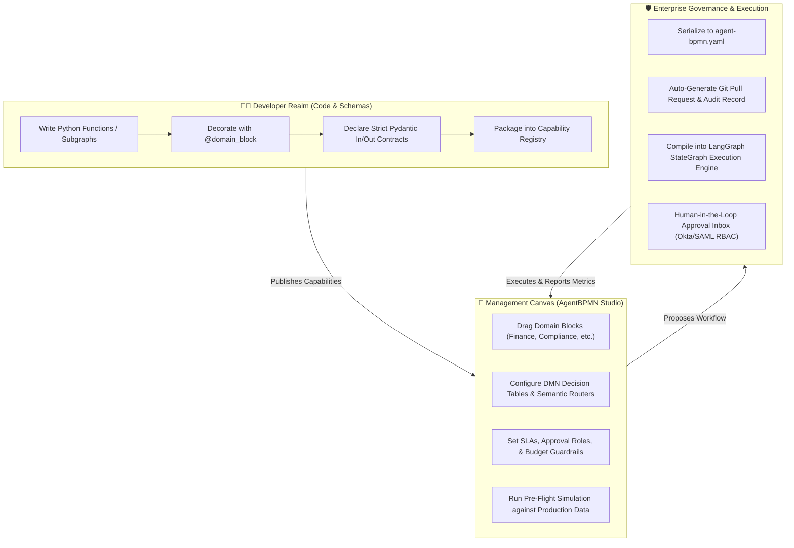

# AgentBPMN (`lang-bpmn`)

> **Enterprise Process Orchestration & Governance for AI Agents** — Bridging the chasm between developer engineering and business process management.

[](https://github.com/Gaurav1258/lang-bpmn/blob/main/LICENSE)
[](#architecture)
[](#the-six-architectural-pillars)

---

## 🎯 The Vision & Core Philosophy

Enterprise AI adoption faces a fundamental dilemma:

1. **Developer-Centric Frameworks (LangGraph, AutoGen, CrewAI):** Offer maximum flexibility, cyclic resilience, and code-level deterministic control, but are inaccessible to compliance officers, product managers, and operations leaders.
2. **Low-Code / Drag-and-Drop Builders (Langflow, Flowise, Dify):** Leak raw prompt engineering, API keys, temperature sliders, and arbitrary code snippets into visual canvases. This turns managers into accidental prompt engineers, results in unmaintainable "spaghetti graphs," and fails compliance and security reviews.

**AgentBPMN enforces strict Separation of Concerns:**

| Dimension | Developer Persona (Engineering) | Management Persona (Business Ops & Compliance) |
| :--- | :--- | :--- |
| **Focus** | How the capability works | How the business process flows |
| **Artifacts** | Python code, Pydantic schemas, LLM prompts, MCP tools, subgraphs | BPMN process canvas, DMN decision tables, SLA timers, routing policies |
| **Control** | Models, system prompts, API integrations, deterministic tests | Approval thresholds, cost/iteration guardrails, human escalations |
| **Governance** | Git repositories, CI/CD regression pipelines, semantic versioning | Audit logs, task inboxes, pre-flight simulation diffs, PR approvals |



---

## 🏛️ The Six Architectural Pillars

### 1. "Domain Blocks" Instead of "Technical Nodes"
* **The Problem:** Technical canvases give users nodes like `ChatAnthropic`, `PostgresRetriever`, or `PythonREPL`. When managers configure these, they inadvertently alter prompts or schemas, causing production regressions.
* **The Solution:** Developers use an SDK decorator (`@domain_block`) to encapsulate complex subgraphs, toolchains, or Model Context Protocol (MCP) servers into business-native modules.
  * Canvas palette is categorized by department (**Compliance**, **Finance**, **Customer Care**, **Risk**).
  * Nodes appear as: `Screen Against Sanctions List`, `Extract Invoice Line Items`, `Draft Vendor Counter-Offer`.
  * **Engineering locks** model selection, temperature, system prompts, and Pydantic schemas under the hood. Business users only map domain parameters.

### 2. Hybrid Routing: DMN Decision Tables + Semantic Routing
* **The Problem:** Routing in existing tools is either brittle code expressions (`state['score'] > 0.8`) or non-deterministic prompt free-text ("Decide where to go next"), neither of which satisfies regulatory and compliance standards.
* **The Solution:** Adapts standard DMN (Decision Model and Notation) to LangGraph conditional edges via two visual routing paradigms:
  * **Deterministic DMN Rule Tables:** Spreadsheet-style decision matrices (e.g., `IF Transaction_Amount > $10,000 AND Risk_Tier == 'High' THEN ROUTE Senior_Auditor_Node`).
  * **Semantic Intent Routers:** Natural-language intent classification buckets configured via simple descriptions; compiled into deterministic structured-output LLM classifiers (Pydantic discriminator enums).

### 3. First-Class "Approval Inbox" (True Enterprise HITL)
* **The Problem:** While LangGraph provides low-level `interrupt_before` and `interrupt_after` hooks, resuming paused execution requires manual state patching via programmatic APIs (`graph.update_state()`).
* **The Solution:** Dropping a `Human Review` node onto the canvas automatically orchestrates an enterprise-ready human-in-the-loop workflow:
  * **Role-Based Routing:** Assigns tasks to Active Directory / Okta / SAML roles (e.g., `role:L2_Compliance_Analyst`).
  * **Dynamic UI Generation:** Parses the current Pydantic state into an auto-rendered **Approve / Edit / Reject** form.
  * **SLA Timers & Escalation:** Visual SLA clocks (e.g., *"If not resolved within 4 hours, auto-escalate to Manager Node"*).
  * **Zero-Code Resume:** Submitting review decisions automatically calls `Command(resume=...)` to resume the graph.

### 4. Cost, Latency & Loop Guardrails as Visual Knobs
* **The Problem:** Cyclic agent flows (e.g., drafting and critiquing loops) can trigger uncontrolled iterations, burning hundreds of dollars in API credits within minutes.
* **The Solution:** Unit economics and circuit breakers are mandatory visual controls on every cyclic edge and node group:
  * **Max Iterations / Retries Slider:** Strict termination condition with explicit fallback/escalation edges.
  * **Budget Cap per Run:** Hard USD / token limits per run (e.g., hard-stop if execution cost exceeds `$0.15`).
  * **Historical Metrics Heatmap:** Process Intelligence visual overlays rendering live node telemetry: **Average Cost ($)**, **P95 Latency (s)**, and **Human Intervention Rate (%)**.

### 5. "Shadow Mode" & Sandbox Simulation (Pre-Flight Testing)
* **The Problem:** Management cannot safely predict how a modified agent workflow will perform against real edge-case workloads before going live.
* **The Solution:** Leverage LangGraph's checkpointer persistence to run "What-If" simulations on production traffic:
  * **Replay Engine:** Re-runs historical production initial states through the modified candidate workflow topology inside an isolated sandbox.
  * **Impact Diff Report:** Generates pre-deployment comparative metrics:
    > *"Candidate workflow routed 12% more cases to Manual Review, reduced net API cost by 18%, and maintained 100% schema integrity across 50 production cases."*

### 6. Git-Backed Governance Without Exposing Git
* **The Problem:** Drag-and-drop builders serialize graph definitions into proprietary database blobs, breaking enterprise audit compliance, version tracking, and code review workflows.
* **The Solution:** The visual canvas is backed by an open declarative specification (`agent-bpmn.yaml`):
  * **No-Git UI for Managers:** Business users click **"Propose Change"** with a required change-rationale comment.
  * **Automated CI/CD Bridge:** Backend automatically creates a feature branch, commits the declarative spec, opens a Git Pull Request, and triggers regression tests.
  * **Regulatory Audit Trail:** Full enterprise lineage (Who changed the routing rule, when, and for what business reason) compliant with SOC2, HIPAA, and financial regulations.

---

## 🏗️ High-Level System Architecture

```
┌────────────────────────────────────────────────────────────────────────┐
│                        AgentBPMN Studio (UI)                           │
│  ┌──────────────────────┬──────────────────────┬────────────────────┐  │
│  │ Domain Block Palette │ Workflow Designer    │ DMN Table Editor   │  │
│  │ (Categorized by Dept)│ (React Flow / BPMN)  │ & Semantic Routers │  │
│  ├──────────────────────┼──────────────────────┼────────────────────┤  │
│  │ Human Approval Inbox │ Guardrail Controls   │ Simulation Diff &  │  │
│  │ (Dynamic State Form) │ (Budget & SLA Knobs) │ Heatmap Analytics  │  │
│  └──────────────────────┴──────────────────────┴────────────────────┘  │
└───────────────────────────────────┬────────────────────────────────────┘
                                    │ Declarative Spec (agent-bpmn.yaml)
                                    ▼
┌────────────────────────────────────────────────────────────────────────┐
│                      AgentBPMN Server & Compiler                       │
│  ┌──────────────────────────────────────────────────────────────────┐  │
│  │ AST Parser & Spec Validator (Pydantic V2)                        │  │
│  ├────────────────────────────────┬─────────────────────────────────┤  │
│  │ DMN Decision Table Compiler    │ Semantic Classifier Synthesizer │  │
│  ├────────────────────────────────┼─────────────────────────────────┤  │
│  │ LangGraph StateGraph Compiler  │ SLA & Escalation Scheduler      │  │
│  ├────────────────────────────────┼─────────────────────────────────┤  │
│  │ Simulation Replay Runner       │ Git Bridge (PR & Audit Tracker) │  │
│  └────────────────────────────────┴─────────────────────────────────┘  │
└───────────────────────────────────┬────────────────────────────────────┘
                                    │
                                    ▼
┌────────────────────────────────────────────────────────────────────────┐
│                 Execution & State Engine (LangGraph Core)              │
│  ┌──────────────────────┬──────────────────────┬────────────────────┐  │
│  │ Domain Block SDK     │ Postgres Checkpointer│ Human-in-the-Loop  │  │
│  │ (@domain_block)      │ (State History)      │ Command(resume=..) │  │
│  └──────────────────────┴──────────────────────┴────────────────────┘  │
└────────────────────────────────────────────────────────────────────────┘
```

---

## 💻 Developer Experience Preview: Defining Domain Blocks

Developers write clean, strongly-typed Python functions or subgraphs. They never hardcode workflow topology—they build reusable business building blocks:

```python
from pydantic import BaseModel, Field
from agent_bpmn.sdk import domain_block

class SanctionCheckInput(BaseModel):
    entity_name: str
    country_code: str
    transaction_amount_usd: float

class SanctionCheckOutput(BaseModel):
    is_flagged: bool = Field(description="True if matching OFAC or PEP list")
    risk_score: float = Field(ge=0.0, le=1.0)
    matched_entries: list[str] = Field(default_factory=list)

@domain_block(
    id="compliance.sanctions_screener",
    name="Screen Against Sanctions List",
    category="Compliance",
    description="Cross-references entity against global sanctions and PEP databases.",
    icon="shield-alert",
    estimated_cost_usd=0.004,
)
async def screen_sanctions(payload: SanctionCheckInput) -> SanctionCheckOutput:
    # Encapsulated developer logic (MCP tools, vector search, LLM prompts)
    ...
```

---

## 📋 Declarative Workflow Specification (`agent-bpmn.yaml`)

The single source of truth saved to Git:

```yaml
version: "1.0"
metadata:
  id: "vendor_invoice_approval"
  name: "Vendor Invoice Approval & Settlement"
  version: "1.2.0"
  owner_department: "Finance Operations"

guardrails:
  max_total_budget_usd: 0.25
  workflow_timeout_seconds: 3600

nodes:
  - id: extract_invoice
    block: "finance.extract_invoice_items"
    
  - id: compliance_screen
    block: "compliance.sanctions_screener"

  - id: routing_decision
    type: "dmn_table"
    rules:
      - condition: "compliance_screen.is_flagged == true"
        target: "compliance_l2_review"
      - condition: "extract_invoice.total_usd > 10000"
        target: "cfo_approval"
      - default: "auto_approve_payment"

  - id: cfo_approval
    type: "human_review"
    assigned_role: "role:finance_executive"
    sla:
      timeout_hours: 24
      escalation_target: "board_delegate_review"

edges:
  - from: extract_invoice
    to: compliance_screen
  - from: compliance_screen
    to: routing_decision
```

---

## 🗺️ Project Status & Development Roadmap

See [ARCHITECTURE_AND_PLAN.md](file:///d:/Projects/lang-bpmn/ARCHITECTURE_AND_PLAN.md) for the end-to-end phased development plan.

- [x] **Phase 1: Foundation & Domain Block SDK**
- [x] **Phase 2: Declarative AST & LangGraph Compiler**
- [x] **Phase 3: Hybrid Routing (DMN Tables + Semantic Enums)**
- [ ] **Phase 4: Enterprise Human-in-the-Loop Inbox**
- [ ] **Phase 5: Visual Studio Canvas (React/Vite)**
- [ ] **Phase 6: Guardrails, Simulation Sandbox & Git Governance**

---

## 📄 License

Distributed under the Apache License 2.0. See [LICENSE](https://github.com/Gaurav1258/lang-bpmn/blob/main/LICENSE) or visit the repository at [https://github.com/Gaurav1258/lang-bpmn](https://github.com/Gaurav1258/lang-bpmn).
